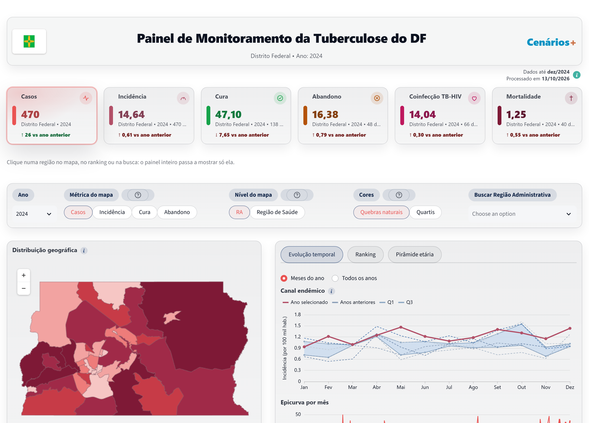
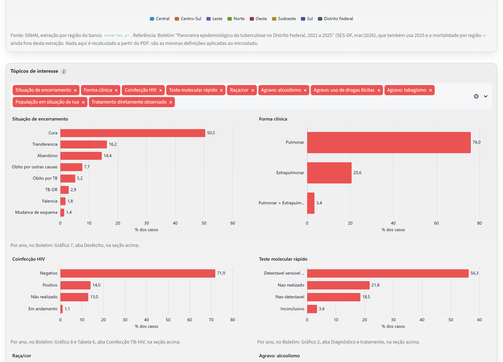

# Painel de Monitoramento da Tuberculose — Distrito Federal

[](https://github.com/Dev-Cenarios/painel-tuberculose-df/actions/workflows/ci.yml)


Painel de vigilância epidemiológica da tuberculose no Distrito Federal, com
mapa por **Região Administrativa** e por **Região de Saúde**, e os números
contados como no Boletim Epidemiológico da SES-DF.

**No ar:** <https://painel.cenarios.unb.br/cenarios/dftb/>



## Sumário

- [Visão geral](#visão-geral)
- [O que o painel mostra](#o-que-o-painel-mostra)
- [Como os números são calculados](#como-os-números-são-calculados)
- [Dados](#dados)
- [Instalação e execução](#instalação-e-execução)
- [Testes](#testes)
- [Estrutura do repositório](#estrutura-do-repositório)
- [Documentação](#documentação)
- [Família Cenários+](#família-cenários)
- [Fontes e créditos](#fontes-e-créditos)
- [Como citar e licença](#como-citar-e-licença)

## Visão geral

O painel responde, para o DF inteiro ou para cada uma das 35 Regiões
Administrativas e 7 Regiões de Saúde, às perguntas que a vigilância da
tuberculose faz primeiro: quantos casos novos, qual a incidência, quantos
se curam, quantos abandonam o tratamento, quantos têm coinfecção com o HIV e
quantos morrem — e como isso se distribui no mapa, no tempo, por idade e
pelos campos da ficha de notificação.

O que este painel tem de diferente dos outros da família é a **Região
Administrativa**. O SINAN nacional não diz em que RA mora cada caso. A
única fonte com essa informação é uma extração nominal do banco do projeto,
e o painel usa só o resultado dela, já sem nenhum identificador (ver
[Dados](#dados)).

## O que o painel mostra

| Bloco | Conteúdo |
|---|---|
| **Indicadores** | Seis cards do ano e do território selecionados, com a variação contra o ano anterior: casos novos, incidência, cura, abandono, coinfecção TB-HIV e mortalidade. |
| **Mapa** | Coroplético clicável por Região Administrativa ou por Região de Saúde, colorido por casos, incidência, cura ou abandono, com quebras naturais ou quartis. |
| **Evolução temporal** | Canal endêmico (ano selecionado sobre a faixa dos anos anteriores), série anual e epicurva mensal. |
| **Ranking e pirâmide** | As regiões ordenadas pela métrica do mapa, e os casos por sexo e faixa etária. |
| **Indicadores do Boletim** | Os gráficos do Boletim da SES-DF por Região de Saúde: incidência, teste molecular rápido, tratamento diretamente observado, contatos, perfil, desfecho, HIV e populações vulneráveis. |
| **Tópicos de interesse** | Distribuição das variáveis da ficha do SINAN (desfecho, forma clínica, HIV, teste rápido, raça/cor, agravos, população em situação de rua…). |

**Tudo segue o clique.** Clicar numa RA ou numa Região de Saúde, no mapa, no
ranking ou na busca, molda o painel inteiro a ela: cards, evolução, pirâmide
e tópicos. Ao entrar numa região, o painel avisa o que muda: a mortalidade
não existe por RA (o SIM não traz RA), a incidência usa população estimada e
parte dos tópicos só existe para o DF inteiro.



## Como os números são calculados

Desde 13/out/2026 o painel conta e calcula como o Boletim "Panorama
epidemiológico da tuberculose no Distrito Federal" (SES-DF):

| Indicador | Como é contado |
|---|---|
| Casos novos | sem reingresso, recidiva, transferência nem mudança de diagnóstico |
| Incidência (por 100 mil) | casos novos ÷ população do IPEDF |
| Cura e abandono (%) | na coorte de casos novos pulmonares com confirmação laboratorial |
| Coinfecção TB-HIV (%) | sobre todos os casos novos |
| Mortalidade (por 100 mil) | óbitos por tuberculose do SIM ÷ população |

Decisões que valem em todo o painel:

- **Recorte por residência, não por notificação.** Sem esse filtro, 15,8%
  das linhas eram de gente de outro município que só veio se tratar no DF.
- **Corte em 2024.** Em 2025, 23,7% dos encerramentos ainda estão como "não
  informado".
- **Incidência por RA é aproximada.** Não existe população por RA ano a ano,
  só a do Censo 2022: o painel aplica a proporção de cada RA no Censo à
  população anual do DF, e diz isso na tela.
- **Proporção só com pelo menos cinco encerramentos.** Abaixo disso, cura e
  abandono ficam em branco — em RA pequena, isso acontece na maioria dos
  anos, e a legenda explica.
- **Zero é zero, não "sem dado".** Uma RA sem caso no ano aparece com 0 no
  mapa, e não em cinza.
- **RIACHO FUNDO e SCIA**, que vêm sem Região de Saúde na fonte, entram na
  Região Centro-Sul, conforme o Decreto 37.515/2016 da SES-DF.

Cada uma dessas decisões tem a medição completa, com data, em
[`tests/paridade/excecoes.md`](tests/paridade/excecoes.md). É também ali que
está a distância entre o painel e o Boletim.

## Dados

O painel lê duas extrações do SINAN-TB do DF, feitas a partir do banco do
projeto Cenários+, mais a população do IBGE/IPEDF, os óbitos do SIM e a
malha das Regiões Administrativas do IPEDF.

| Extração | De onde vem | O que sustenta |
|---|---|---|
| `sinan_df` | `silver.tuberculose` (já sem identificador na origem) | as variáveis dos tópicos que só existem para o DF inteiro |
| `sinan_df_ra` | `dados_geolink."DF_geo_TB"`, com a RA de cada caso | os números da tela, o mapa e o ranking |

- **Nenhum dado nominal entra no projeto.** A segunda fonte é nominal, e o
  script `scripts/extrair_sinan_df_geolink.py` descarta nome, nome da mãe,
  CNS, prontuário, endereço e coordenadas antes de gravar qualquer arquivo. A
  coordenada só é usada, dentro do script, para atribuir a RA quando o rótulo
  do banco não traz.
- **Os dados não estão no repositório.** A extração exige acesso ao banco do
  projeto (VPN e credenciais, que ficam num `.env` fora do git). Quem for
  rodar o painel pede os arquivos à equipe do Cenários+.
- O `tests/test_segredos.py` varre o repositório a cada execução atrás de
  credencial versionada.

Para gerar os dados, com o `.env` preenchido a partir do `.env.exemplo`:

```bash
python -m scripts.extrair_sinan_df            # KPIs do DF inteiro
python -m scripts.extrair_populacao_df        # denominador da incidência e da mortalidade
python -m scripts.extrair_obitos_tb_df        # numerador da mortalidade (SIM)
python -m scripts.extrair_sinan_df_geolink    # casos com a RA, sem identificador
python -m scripts.preparar_geometria          # malha das 35 RA e das 7 Regiões de Saúde
python -m scripts.preparar_microdado          # reparticiona os parquets por ano
```

## Instalação e execução

Requisitos: Python 3.13 e os dados (ver acima).

```bash
git clone https://github.com/Dev-Cenarios/painel-tuberculose-df.git
cd painel-tuberculose-df
python -m venv .venv && .venv/Scripts/activate        # Linux/macOS: source .venv/bin/activate
pip install -r requirements.lock.txt
streamlit run app.py
```

O painel abre em <http://localhost:8501>. Para subir como no servidor:

```bash
docker compose up -d --build
```

## Testes

```bash
pytest                                   # a suíte inteira com os dados
pytest -rs                               # mostra o motivo de cada teste pulado
ruff check --select F app.py src tests   # nome indefinido, import quebrado, código morto
```

Sem os dados, `pytest` roda só o que não depende deles e diz o que pulou. As
duas extrações são conferidas **separadamente**: um clone pode ter uma sem a
outra. É o que o CI faz a cada push, junto com a construção da imagem Docker.

A suíte cobre, entre outras coisas: as fórmulas de cada indicador; a
atribuição de RA por coordenada; a lista cheia de regiões, com zero onde não
houve caso; a paridade entre as duas fontes, que precisa bater com o
registrado em `excecoes.md`; e a tela inteira por `AppTest`.

## Estrutura do repositório

```
painel-tuberculose-df/
├── app.py                        composição da tela
├── src/
│   ├── estado.py                 navegação: doença e ano
│   ├── grafico_componente.py     os gráficos como opções ECharts
│   ├── grafico_boletim.py        os gráficos do Boletim da SES-DF
│   ├── componente_grafico/       ECharts vendorado + protocolo do Streamlit
│   ├── data/                     leitura, indicadores, canal, boletim e a fachada painel.py
│   ├── doencas/tuberculose.py    o pack da doença
│   └── theme/                    identidade visual e o mapa do DF
├── scripts/                      extração, geometria, prévia do link
├── tests/                        suíte pytest, com tests/paridade/
├── docs/                         guia de desenvolvimento
├── vendor/                       o núcleo comum dos painéis (mapa e contenção de falha)
├── assets/                       bandeira do DF e prévia do link
├── .github/workflows/ci.yml      CI
├── Dockerfile · docker-compose.yml
└── requirements.txt · requirements.lock.txt
```

## Documentação

| Arquivo | Para quem | O que tem |
|---|---|---|
| [`tests/paridade/excecoes.md`](tests/paridade/excecoes.md) | quem compara com outra fonte | cada decisão de dado, com a medição e a data, e a distância ao Boletim |
| [`docs/desenvolvimento.md`](docs/desenvolvimento.md) | quem mantém o código | comandos, arquitetura e as regras que falham em silêncio |

## Família Cenários+

| Painel | Recorte | Repositório |
|---|---|---|
| Tuberculose — Distrito Federal (este) | por Região Administrativa e Região de Saúde | [Dev-Cenarios/painel-tuberculose-df](https://github.com/Dev-Cenarios/painel-tuberculose-df) |
| Tuberculose — Pernambuco | estado, por município e região de saúde | [Dev-Cenarios/painel-tuberculose-pernambuco](https://github.com/Dev-Cenarios/painel-tuberculose-pernambuco) |
| Hanseníase — Pernambuco | estado, por município e região de saúde | [Dev-Cenarios/painel-hanseniase-pernambuco](https://github.com/Dev-Cenarios/painel-hanseniase-pernambuco) |

## Fontes e créditos

- **Dados:** SINAN e SIM — Ministério da Saúde; população — IBGE e IPEDF;
  malha das Regiões Administrativas — IPEDF; setores censitários — Censo
  2022 (IBGE). Referência externa: Boletim "Panorama epidemiológico da
  tuberculose no Distrito Federal" (SES-DF). Dados preliminares, sujeitos a
  alteração: o SINAN é atualizado retroativamente.
- **Desenvolvimento:** projeto Cenários+ — Universidade de Brasília.

## Como citar e licença

Se usar o painel ou o código num trabalho, use o botão **"Cite this
repository"** aqui no GitHub, que lê o [`CITATION.cff`](CITATION.cff).

O código é aberto, sob a licença [MIT](LICENSE): pode ser usado, copiado e
adaptado, desde que o aviso de copyright do Projeto Cenários vá junto. A
licença vale para o código. Os dados são do Ministério da Saúde, do IBGE, do
IPEDF e da SES-DF, e seguem as regras de cada fonte.
